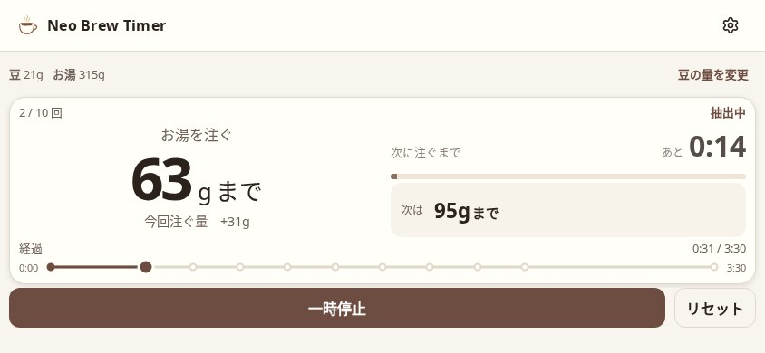

# Neo Brew Timer｜ケトルを持ったまま、10回注げるか

[豆21gの注湯を試す](https://improve-brew-workflow.neo-brew-timer.pages.dev/ja/intro) · [実装と変更履歴](https://github.com/takatama/neo-brew-timer/pull/29)

粕谷哲さんのNeo Brewは、最初の蒸らしを終えると15秒ごとに次の一湯が来る。豆21gなら、最初の目標は32g。次に31gを足した時、スケールに出てほしい数字は63gだ。前の一湯を少し注ぎすぎたら、今回も63gで止めればよい。Neo Brew Timerが一番大きく表示するのは、その数字だ。

## 誰の、どの瞬間を助けるか

以下は設計上のペルソナで、利用者へのインタビュー結果ではない。

**主な利用者は、自宅でドリップする習慣があり、Neo Brewを何度か試したい人。** 重さだけを表示するスケールを使い、スマホはその横に置く。最初に豆を量る余裕はある。ケトルを傾けた後にレシピをスクロールしたり、時計と表を突き合わせたりする余裕は少ない。成功の目安は、スタート後にスマホへ触れず、スケールの数字を追って10投を終えられること。

**もう一人は、作品のリンクを受け取った人。** 今は豆も器具も手元にない。最初の2投を自分で進めて、32gが63gに変わるところを見るだけで作品の狙いが伝わるか。紹介画面には、実際のレシピ計算を使う試用欄を用意した。試しても普段の豆量やタイマーの状態は変わらない。

## 一杯を通して見る

| 場面 | その人の問い | 画面での答え | 検証のしかた |
| --- | --- | --- | --- |
| リンクを開く | 手持ちのスケールで使える？ | ゼロ合わせは最初の一度。豆21gで次の一湯を試せる | 初回の入口から、タイマーを起動せず2投目を表示 |
| 豆を量る | 今日は21g。お湯はいくら用意する？ | 豆量を変えると総湯量315gと最初の32gが出る | 直接入力した値を抽出画面まで引き継ぐ |
| 蒸らしから2投目へ | 追加で63g？ 合計で63g？ | 大きく「63gまで」、その下に「今回注ぐ量 ＋31g」 | シミュレーションで全10投の累計目標を照合 |
| 手を離せない | 操作ボタンで次の情報が隠れない？ | 小画面では縦の余白を縮め、横置きでは目標と予告を左右に配置 | 残り時間・タイムライン・ボタンの表示位置をブラウザーで計測 |
| 飲んでから翌朝へ | あの挽き目と豆量でもう一度淹れたい | 完成後に任意でメモを保存。次の準備画面で日付・豆量・本文を表示 | 保存後に再読み込みし、別の豆量から前回量へ戻す |

## 一度はテストを通過し、それでも見落としたこと

以前のブラウザーテストは、タイマーの進行やボタンの操作を確認していた。ところが320×568の画面では、下部のボタンがタイムラインに重なった。844×390の横画面では残り時間まで隠れた。要素が画面に存在するだけでは、ケトルを持った人が読める保証にはならない。このため、同じ2投目で各要素の座標を確認し、狭い画面の配置を変更した。

時間と豆量から分かる範囲も決まっている。タイマーはスケールの実測値を受け取らない。各回の累計目標を丸め、その差を今回の注湯量にして、最後に315gと一致させる。落ち切った瞬間は検出できないので、3分30秒は完成の目安として扱う。

## 次に台所で確かめたいこと

初使用の人に、普段使っているスケールの隣に自分のスマホを置いてもらう。豆21gを使い、音を消し、操作方法を教えずに一杯淹れてもらう。観察するのは、2投目で目指した数字、途中でスマホに触れた回数と理由、次の注湯に遅れた場面。最後に「明日もう一度同じ条件で淹れるなら、何を見ますか」と聞く。

この観察は未実施。画面サイズ、時計、保存状態を制御できるブラウザーテストと、湯気や照明のある台所での読みやすさを別々に評価する。
